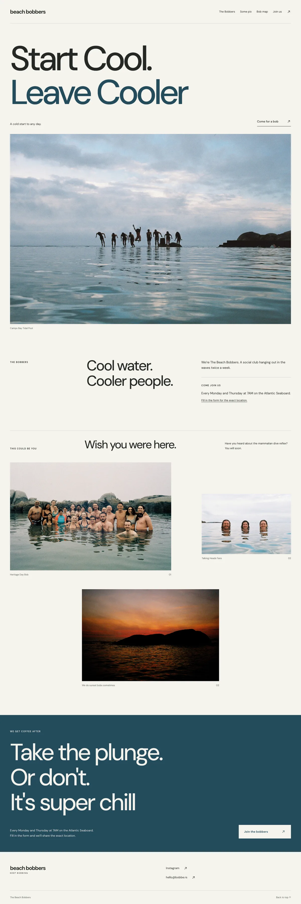

# Beach Bobbers

Start Cool. Leave Cooler. A social ocean-swimming club on the Atlantic Seaboard.



## Develop

Use Node.js 22.19 or newer (Node 22 LTS recommended) and npm.

```sh
npm ci
npm run dev
```

For a production preview, including the join redirects:

```sh
npm run check
npm run build
npm run preview
```

Open the local URL printed by the server. Wrangler serves the build locally without a Cloudflare login.

## How it fits together

Astro generates static HTML with Tailwind CSS and no application JavaScript. Section components share a layout; club details live in `src/config`, and gallery entries live in `src/data`. Photographs are optimised at build time from the small copies in `src/assets`. DM Sans is self-hosted with its licence.

Cloudflare Workers serves `dist`; `/join` redirects to the club’s Google Form. GitHub Actions validates pull requests and main-branch changes. Deployment is a separate step after review.

## Contribute

See [CONTRIBUTING.md](CONTRIBUTING.md) for adding photos, checking the UI and preparing changes.

Find us on [Instagram](https://www.instagram.com/beachbobbers/) or email [hello@bobbe.rs](mailto:hello@bobbe.rs).
